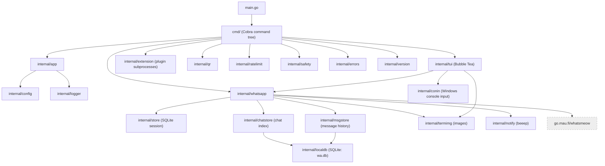
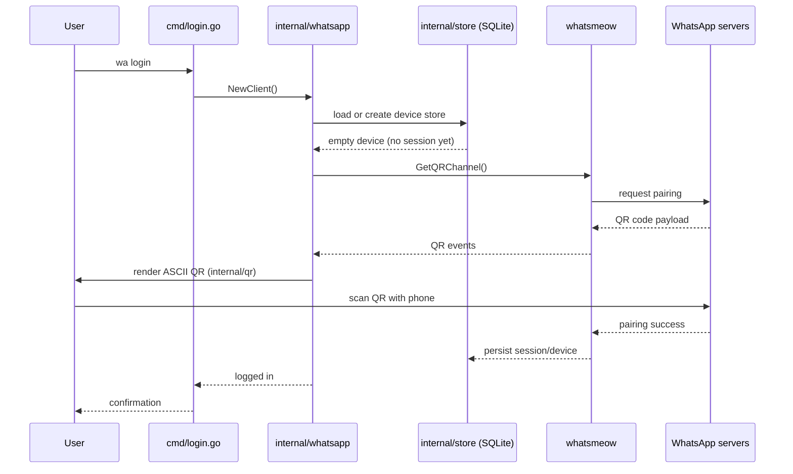
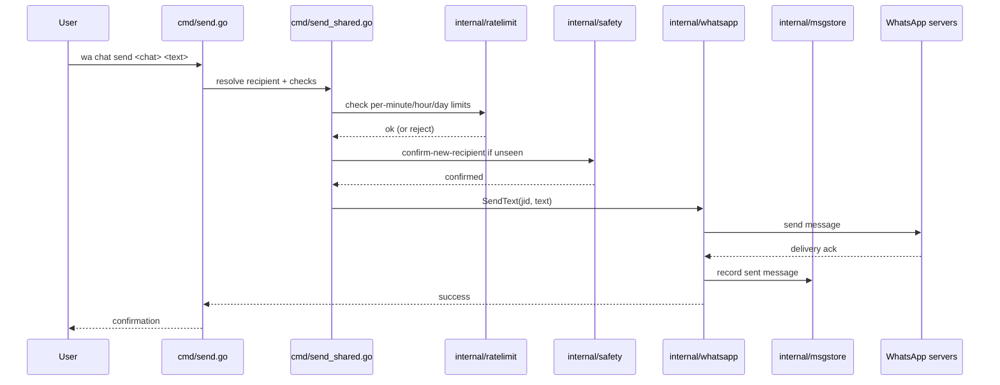
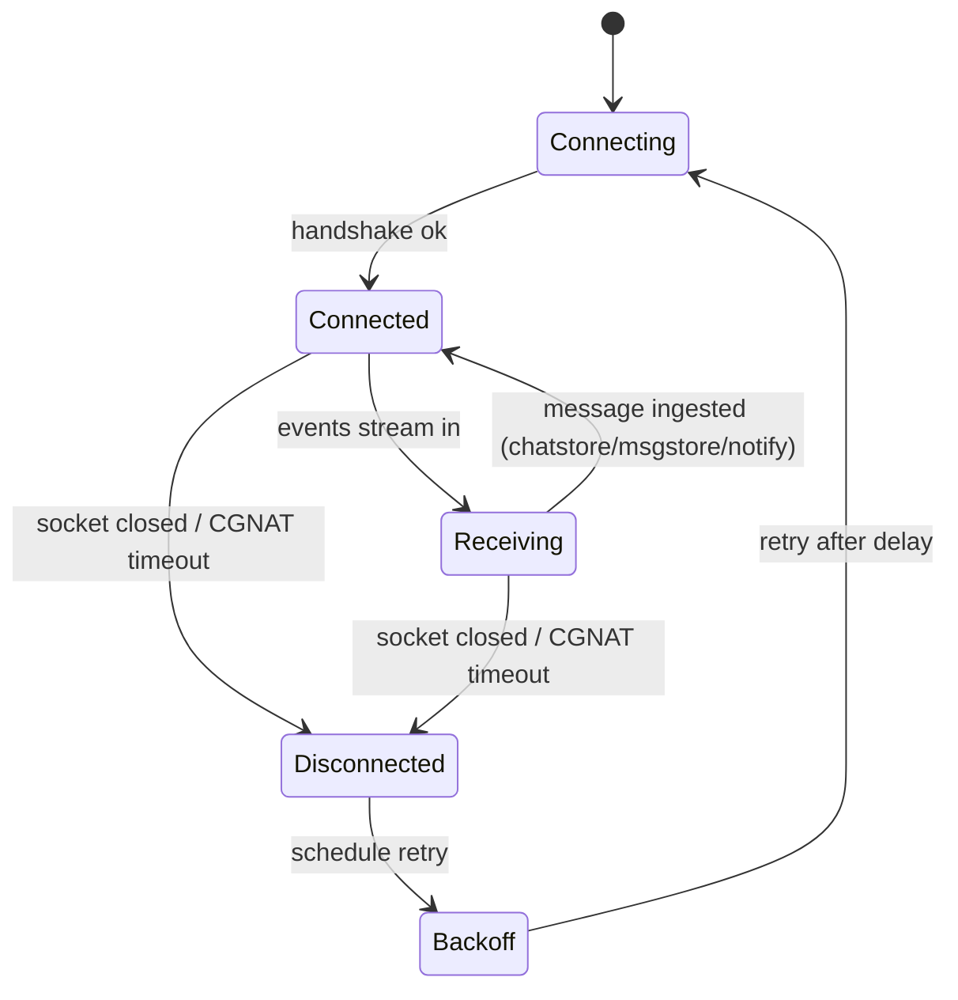

# Architecture

This document is a map of wa-cli's codebase: how the packages fit
together and why they're split the way they are. For what's built vs.
planned, see [ROADMAP.md](./ROADMAP.md). For end-user usage, see
[README.md](./README.md).

## Overview

```
main.go
  └── cmd/                  Cobra command tree (one file per command/group)
        └── internal/app    Shared dependencies handed to every command
              ├── internal/config     Load/save config.json
              └── internal/logger     Structured logging (slog)

        └── internal/whatsapp        whatsmeow wrapper: the actual WhatsApp client
              ├── internal/store       Session/device persistence (SQLite)
              ├── internal/chatstore   Local chat index      ┐ one SQLite file,
              ├── internal/msgstore    Local message history ┘ via internal/localdb
              ├── internal/termimg     Image decoding/scaling within a memory budget
              └── internal/notify      Desktop notifications (beeep)

        └── internal/tui              Full-screen terminal UI (Bubble Tea)
              ├── internal/conin       Windows console input (pastes, Shift+Enter)
              └── internal/termimg     Drawing photos (Sixel, Kitty, iTerm2, blocks)
        └── internal/extension        Plugin system (git-cloned subprocesses)
        └── internal/qr               ASCII QR rendering for login
        └── internal/ratelimit        Persisted send-rate limits
        └── internal/safety           Send guardrails (confirm-new-recipient, etc.)
        └── internal/errors           Shared error wrapping
        └── internal/version          Build-time version metadata
```

`main.go` is a two-line entrypoint that hands off to `cmd.Execute()`
immediately — all real logic lives under `cmd/` and `internal/`.

### Package dependency graph



Dashed box marks the one external dependency everything in
`internal/whatsapp` ultimately routes through.

## `cmd/` — the command tree

One file per command or command group (`chat.go`, `contact.go`,
`group.go`, `media.go`, `config.go`, `extension.go`, `completion.go`,
`login.go`, `logout.go`, `status.go`, `send.go`/`reply.go`/`forward.go`,
`watch.go`, `version.go`, `root.go`), each self-registering onto
`rootCmd` from its own `init()`. `root.go` builds the shared `app.App`
(`var a *app.App`) once at package init time, before any command's
`RunE` runs, so every command can assume `a.Config`/`a.Log` are ready.

A few cross-cutting helpers live alongside the commands rather than in
`internal/` because they're specific to the CLI layer, not reusable
library code:

- **`cmd/json.go`** — the `--json` flag, `useJSON(cmd)` (flag overrides
  the `jsonOutput` config default for one call), and `printJSON`, the
  single encoder every JSON-mode command funnels through.
- **`cmd/stdlog.go`** — `captureLibraryStdout(fn)`, which redirects
  `os.Stdout` to `os.Stderr` for the duration of any whatsmeow call.
  whatsmeow's own logger (`waLog.Stdout`, see `internal/whatsapp`) writes
  directly to the process-wide stdout with no injectable writer; without
  this, a stray log line can land ahead of or inside a command's JSON
  output and break anything parsing it (`wa chat list --json | jq`).
  `internal/tui` hit the same problem and solved it the same way
  (redirect to a log file instead, since the TUI owns the whole screen).
- **`cmd/send_shared.go`** — the resolve-recipient / rate-limit /
  confirm-new-recipient logic shared by `chat send`, `chat reply`,
  `chat forward`, and `media send`.

## `internal/app` — shared dependencies

Deliberately tiny: loads config, builds a logger, returns an `*App`.
Notably, a broken config file (invalid JSON) does **not** abort startup
— `app.New()` warns to stderr and falls back to in-memory defaults, so
`wa config edit` (the one command that can fix a broken config file)
stays runnable even when the file it needs to fix is the thing that's
broken. Hard-failing here would strand anyone with a broken config with
no command that could rescue them.

## `internal/whatsapp` — the WhatsApp client

Wraps whatsmeow (`go.mau.fi/whatsmeow`), exposing a smaller, wa-cli-
shaped API (`Client.ListChats`, `SendImage`, `GroupInfo`, etc.) rather
than leaking whatsmeow's types everywhere. This is the one package that
talks to WhatsApp's servers; everything else in `cmd/` goes through it.

`SetNotifications` is called explicitly by `wa watch` and the TUI only
— not by one-shot commands that briefly construct a client (`chat list`,
`contact list`, ...) — so a five-second `chat list` sync never pops a
desktop notification.

### `wa login` sequence



### `wa chat send` sequence



### `wa watch` reconnect behavior



## Local state: three separate stores, three separate reasons

wa-cli keeps three distinct pieces of local state, each for a different
reason — they're not interchangeable, and merging them would lose the
property each one exists for:

- **`internal/store`** — whatsmeow's own SQLite device/session store.
  This is what makes `wa login` persist across runs; whatsmeow owns its
  schema, wa-cli just points it at a data directory.
- **`internal/chatstore`** — the local index of chats (name, JID, last
  message preview, unread count, pin/archive/mute state, draft) so `wa
  chat list/search/info` and the TUI's chat list have something to read
  *without* a network connection, across separate invocations.
- **`internal/msgstore`** — the local message history: one row per
  message with its current state (delivery status, edited/deleted,
  reactions, poll votes), so the TUI can page through a chat and `wa chat
  reply`/`forward`/`media download` can reference a message later, in a
  separate process.

`chatstore` and `msgstore` share one SQLite file, `wa.db`, opened once
per process by **`internal/localdb`** (the same pure-Go driver whatsmeow's
own store uses, so no extra dependency). They used to be two JSON files
rewritten in full on every incoming message and re-read in full on every
redraw - about 20 MB of garbage per message on a busy account, which is
also why history was capped at 48 hours. With SQLite a message is one
small write, reads are paged, memory no longer grows with history, and
two `wa` processes (a `wa chat send` while the TUI is open) can't
overwrite each other. The old `chats.json`/`messages.json` are imported
once and renamed to `*.migrated`. The TUI has that import done by a
short-lived helper process (`wa migrate-store`, hidden): parsing the whole
old history at once is the most memory-hungry thing wa-cli ever does, and
a process doesn't give all of that memory back.

### One row per message

WhatsApp delivers reactions, edits, deletions, poll votes and the HD
version of a photo as separate messages that *refer to* an earlier one.
`internal/whatsapp` folds each of them into the message it belongs to
as it arrives (and once, at startup, for history imported from the old
JSON store) instead of storing it as its own row. That is what lets the
TUI show a message with its reactions underneath, its edited text, and
the HD photo in place of the standard one - and it keeps unread counts
and notifications honest (a reaction is not a new message).

### One chat per person

WhatsApp is moving accounts from phone-number IDs
(`...@s.whatsapp.net`) to privacy IDs (`...@lid`); the same conversation
can arrive under either. `internal/whatsapp` maps a privacy ID to the
phone number whenever whatsmeow knows the pairing, and merges chats that
were stored under both, so a person appears once in the chat list.

## `internal/tui` — the full-screen interface

Built on Bubble Tea and Lip Gloss. Runs when `wa` is invoked with no
subcommand. Owns the whole terminal for its run, which is why it needs
its own stdout redirect (to a log file, not stderr like
`captureLibraryStdout` — there's no "interactive terminal" to print
warnings to while the TUI has the screen).

The TUI never touches whatsmeow, protobufs or the stores. It talks to a
`Backend` interface (`internal/tui/backend.go`) that `*whatsapp.Client`
implements, and is told about changes through typed events
(`internal/whatsapp/api.go`: a message was added or changed, a chat's
list entry changed, someone is typing, the connection dropped). That
seam is what makes it testable: the unit tests drive the real model
with a fake backend, and `WA_DEMO=1 wa` runs the real program on an
in-memory pretend WhatsApp (`demo.go`) - which the Windows end-to-end
test launches inside a pseudo console to type and paste into it.

```
keys, mouse, resize ──┐                       ┌── tea.Cmd: Backend calls
  (conin on Windows)  ├─► model.Update ───────┤     (load a page, send, react…)
WhatsApp events ──────┘     │                 └── results come back as messages
                            ▼
                        model.View ─► chat list │ header, messages, message box
```

- `model.go` holds the state and reacts to every event; `keys.go` maps
  keys to actions for whichever area has focus (chat list, message box,
  a selected message) or whatever is temporarily on top (a question,
  the reaction picker, an overlay, the photo viewer).
- `messages.go` keeps only a window of the open chat in memory (80
  messages at a time, more as you scroll up) and draws each message
  once, re-drawing it only when it, the width, or its picture changes.
  The scroll position is counted from the bottom, so older pages can be
  added above without anything moving.
- `editor.go` is the multi-line message box. Line breaks are ordinary
  characters in it; only a deliberate Enter sends.
- `viewer.go` shows a photo full screen. Pixels can't go through Bubble
  Tea (it only knows text), so the viewer shows an empty frame and
  writes the picture straight to the terminal over it.

### Why Windows has its own input reader (`internal/conin`)

Bubble Tea v1 reads the Windows console one key record at a time. A
paste arrives as a stream of key presses in which every line break is
an Enter - indistinguishable from the user pressing Enter - so pasted
multi-line text used to be sent as one message per line. `conin` reads
the console itself: key presses that arrive together in one batch can
only be a paste, and are delivered as a single paste message, the same
shape Bubble Tea produces on Unix terminals (which mark pastes
explicitly). Reading the console directly also provides what Bubble
Tea's reader drops: Shift+Enter, focus changes (used to show you as
online only while the window is focused), and whole emoji instead of
half surrogate pairs. Where neither `conin` nor bracketed paste is
available, the model falls back to timing: an Enter that arrives within
a few milliseconds of another key is a pasted line break, not "send".

### Memory

The budget is 100 MB for everything. What keeps it there:

- messages are paged from SQLite, never loaded wholesale;
- names are resolved once and cached, not looked up per message per
  frame;
- in-chat pictures are drawn from the thumbnail embedded in the
  message, one at a time, and only the drawn text is kept (bounded);
- a full-size photo is downloaded to disk, decoded only if its decoded
  size fits `termimg.DefaultBudget` (checked from the header first),
  scaled to the screen immediately, and released before drawing;
- files being sent are uploaded from disk as a stream;
- the Go runtime is given a soft limit (`debug.SetMemoryLimit`) below
  the budget, since SQLite's caches live outside the Go heap.

## `internal/extension` — the plugin system

Extensions are plain git repositories with a `wa-extension.json`
manifest (name/description/entrypoint), cloned into
`extensions/<name>/` under the config directory and run as ordinary
subprocesses — not Go plugins (`.so` files need an exact toolchain match
and don't exist on Windows at all, which would break the cross-platform
goal from Phase 0). `Install` clones to a temp directory first and
validates the manifest/entrypoint before ever touching the real
extensions directory, and rejects path traversal in both `name` and
`entrypoint`.

## Supporting packages

- **`internal/config`** — loads/saves `config.json` from
  `$XDG_CONFIG_HOME/wa/` (or platform equivalent). `cmd/config.go`'s
  `configFields` table (name, typed getter, validating setter) is the
  single source of truth for every setting `get`/`set` know about, so
  the two commands can't drift out of sync with each other or with the
  `Config` struct itself.
- **`internal/ratelimit`** / **`internal/safety`** — send-side
  guardrails (`maxMessagesPerMinute/Hour/Day`, confirm-before-messaging-
  a-new-recipient) so a scripting mistake — a bad loop, a typo'd contact
  list — can't turn wa-cli into an accidental bulk-messaging tool.
  `ratelimit` persists its counters to disk specifically because each
  `wa` invocation is a short-lived process; an in-memory-only limiter
  would reset on every single command.
- **`internal/qr`** — renders WhatsApp's pairing code as an ASCII QR
  code for `wa login`.
- **`internal/errors`** — thin wrapping helpers (`Wrap`/`Wrapf`) around
  the standard library's `errors` package, used for consistent
  "context: underlying error" messages across the codebase.
- **`internal/logger`** — thin wrapper around `log/slog`, configured
  from `Config.LogLevel`/`Config.JSONOutput`.
- **`internal/version`** — build-time metadata (version/commit/date),
  overridden via `-ldflags` at build time; backs `wa version`.

## Dead code

**`internal/cli`** is a hand-rolled command router built early on,
before Cobra's dependencies were reachable in the original build
environment (see the note at the bottom of ROADMAP.md). Nothing imports
it anymore — `cmd/` has used real `github.com/spf13/cobra` since. It's
still sitting in the tree and is a reasonable candidate for deletion
whenever someone's doing cleanup; noted here rather than silently
removed, since it's not this document's place to make that call.
